<p align="center">
  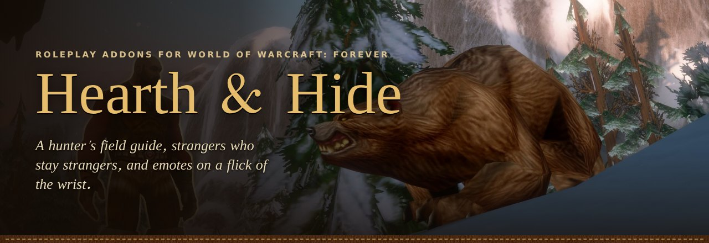
</p>

<p align="center">
  <b>Three roleplay addons for World of Warcraft: Forever.</b><br>
  A hunter's field guide, strangers who stay strangers, and emotes on a flick of the wrist.
</p>

<p align="center">
  <a href="https://github.com/actualraptor/hearth-hide/raw/main/downloads/HearthAndHide.zip"></a>
  
  
</p>

<table align="center">
  <tr>
    <td align="center" width="33%">
      <a href="#hunters-journal">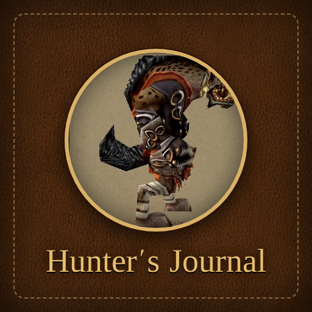</a><br>
      <sub>A Monster Hunter–style field guide that fills in as you hunt.</sub><br><br>
      <a href="https://github.com/actualraptor/hearth-hide/raw/main/downloads/HuntersJournal.zip">Download</a> · <code>/hj</code>
    </td>
    <td align="center" width="33%">
      <a href="#well-met">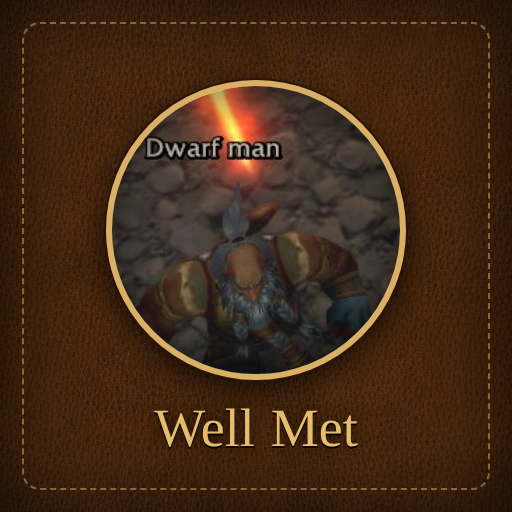</a><br>
      <sub>Strangers' names stay hidden until they tell you who they are.</sub><br><br>
      <a href="https://github.com/actualraptor/hearth-hide/raw/main/downloads/WellMet.zip">Download</a> · <code>/wellmet</code>
    </td>
    <td align="center" width="33%">
      <a href="#mannerisms">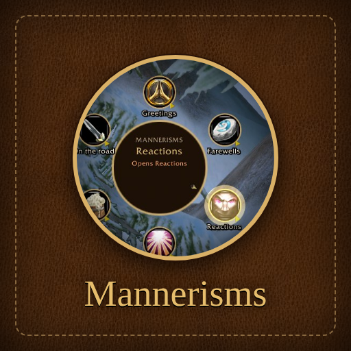</a><br>
      <sub>Hold a key, flick toward an emote, let go. RP on a ring menu.</sub><br><br>
      <a href="https://github.com/actualraptor/hearth-hide/raw/main/downloads/Mannerisms.zip">Download</a> · <code>/mm</code>
    </td>
  </tr>
</table>

Each addon works on its own. Together they share your [Total RP 3](https://www.curseforge.com/wow/addons/total-rp-3) profile, so your name, pronouns and profession show up everywhere they should.

---

## Hunter's Journal

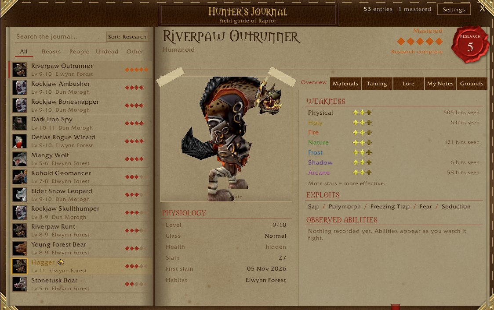

Every creature you meet gets a page in a leather-bound field guide. Each kill raises its **research level** and unlocks more of the page.

| Level | Unlocks |
|---|---|
| 1 · Sighted | Name, type, level range and where you found it |
| 2 · Slain | Physiology, taming info, hunting grounds |
| 3 · Studied | Weakness stars, exploits, abilities you've seen it use |
| 4 · Catalogued | Materials: drop rates from corpses you've looted |
| 5 · Mastered | Lore and your record: kills, first kill, largest specimen |

- Weakness stars and drop rates come from **your own** fights and loot, not a database.
- Elites, rares and bosses stand out; research pips appear on nameplates.
- Hunting grounds on the world map, with the creature's portrait where you've made kills.
- In-character notes, and a one-click emote when research levels up.

<p>
  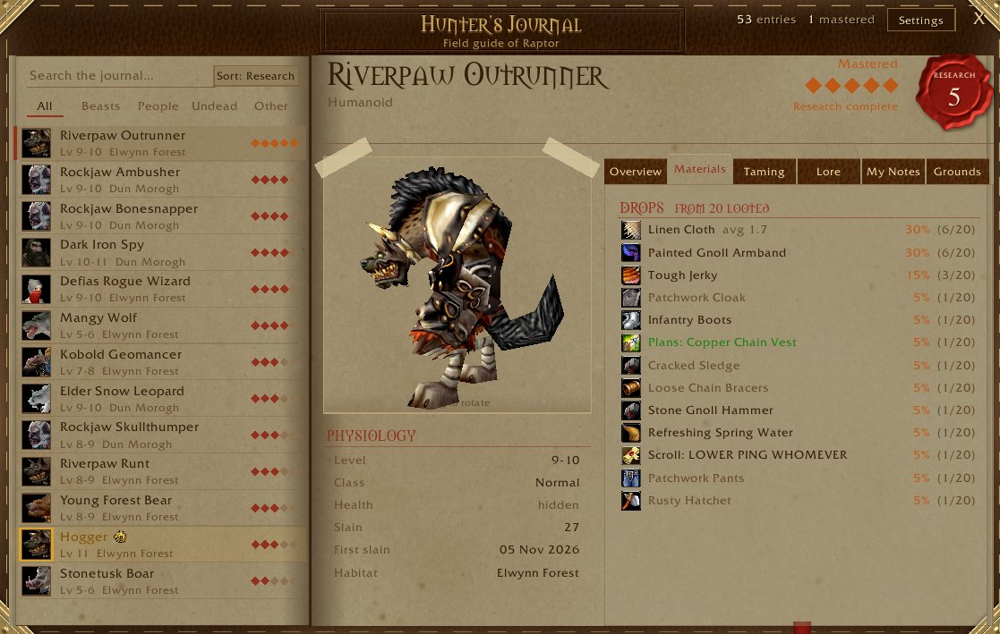
  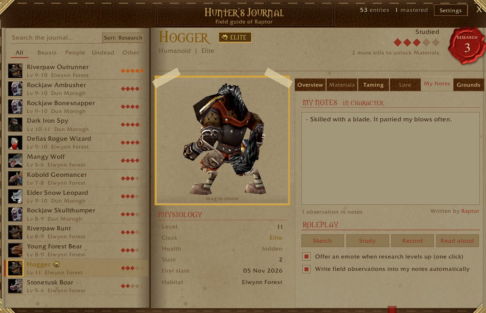
</p>
<p>
  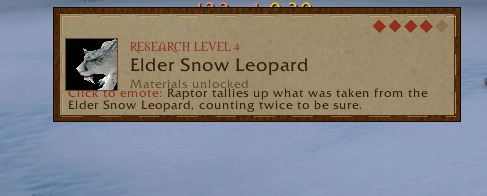
  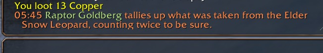
</p>

## Well Met

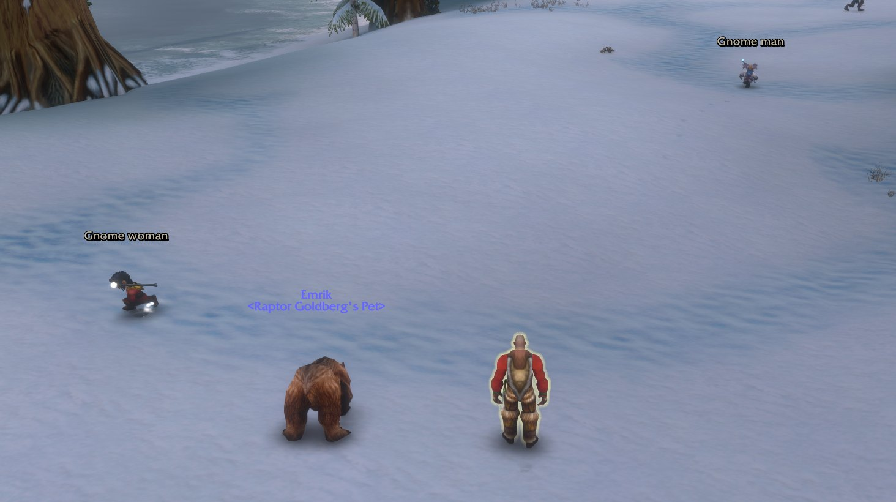

On an RP server everyone's name hangs over their head. Well Met covers players' names until you'd actually know them. Until then they're **Gnome woman**, **Dwarf man**, or just **Stranger**.

- **Learn names in character.** When someone says their name in `/say`, `/emote` or a whisper, you know them from then on. Their Total RP 3 name counts too.
- Guildmates, your group, your friends list and anyone you've set a **Total RP 3 relationship** with count as known.
- Hidden on nameplates, your target frame (keeps the level: `13 | Gnome woman`) and tooltips, including Total RP 3's own nameplate names, target bar and companion tooltips.
- Players too far for a nameplate show no name at all, and pets stop giving their owner away.
- The game's emote lines too: *You thank the Human woman.*
- Local chat as well: **[Human woman] says:** in `/say`, `/yell` and `/emote` until they tell you their name. Trade, General, party and guild are left alone. *(Needs the game's standard chat; it switches itself off with EllesmereUI's chat module.)*
- Optional: only hide players who use **Total RP 3**, and show everyone else's name.
- Tooltips say whether someone uses **Total RP 3** and if they're **in character**.
- An **introduce button** sits by your target frame and glows while they're a stranger. It sends a line built from your TRP3 profile.
- Works with Blizzard's frames and **EllesmereUI**.

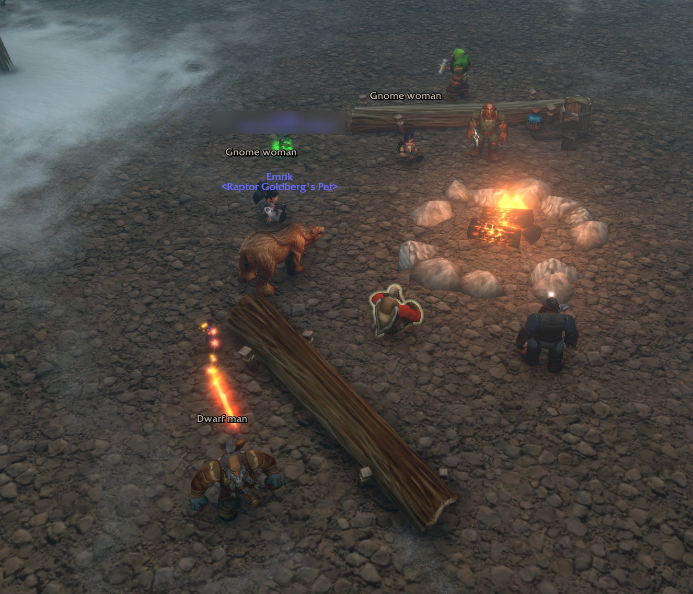

## Mannerisms

<p>
  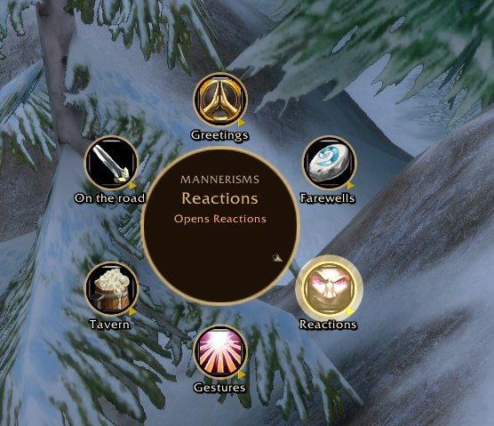
  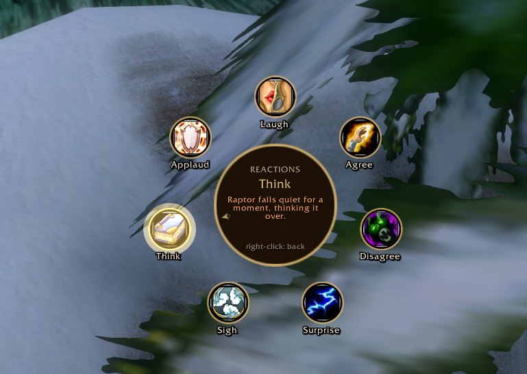
</p>

A ring menu for roleplay, inspired by OPie. **Hold a key** and a ring opens around your cursor. Rest on a category to open it, move toward an emote and **let go**.

- Six rings to start: greetings, farewells, reactions, gestures, tavern and the road. Around 35 slices.
- Each slice has several lines and picks one at random, so you never repeat yourself.
- `/me` emotes, spoken lines, or the game's own animated emotes.
- `{target}` becomes your target's name, or *the dwarf man* if Well Met says you haven't met.
- Build your own rings in-game, with up to six keys.

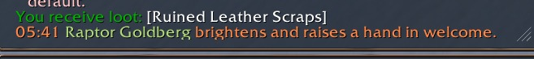

> **New to `/me`?** It describes what your character does, in third person. `/me leans on the bar.` shows *Raptor leans on the bar.* to everyone nearby.

---

## Install

1. Download [the whole kit](https://github.com/actualraptor/hearth-hide/raw/main/downloads/HearthAndHide.zip), or one addon from the table above.
2. Unzip into your AddOns folder so each addon's folder sits directly inside it:
   ```
   World of Warcraft\_forever_\Interface\AddOns\
     HuntersJournal\
     WellMet\
     Mannerisms\
   ```
3. Start the game. Linux works the same: unzip into `_forever_/Interface/AddOns/` inside your Wine prefix.

Total RP 3 is optional but recommended.

## Commands

| Command | Does |
|---|---|
| `/hj` | Open the Hunter's Journal (`/hj settings`, `/hj map`) |
| `/wellmet` or `/wmet` | Well Met settings and your introductions |
| `/wmet know` | Mark your target as known, or a stranger again |
| `/wmet intro` | Introduce yourself |
| `/mm` | Edit your rings and keys |

Keybindings for all three are under *Options › Keybindings › AddOns*.

## Credits

Leather texture "Brown Leather" by [Poly Haven](https://polyhaven.com/a/brown_leather), paper texture "Paper 006" by [ambientCG](https://ambientcg.com/view?id=Paper006), both CC0. Screenshots by Raptor Goldberg, with Emrik; other players' names are hidden or blurred. Not affiliated with Blizzard Entertainment or Capcom.
