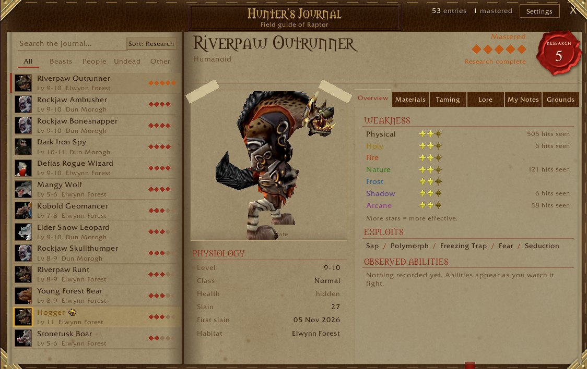
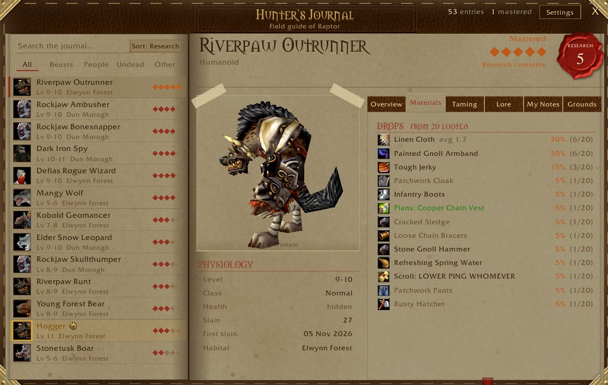

# Hunter's Journal

**Name:** Hunter's Journal
**Summary:** A Monster Hunter–style field guide. Research creatures by hunting them: weaknesses, drop rates, taming, lore and hunting grounds.
**Game:** World of Warcraft: Forever · interface 16001
**Categories:** Bestiary / Data Collection, Roleplay, Hunter, Map & Minimap
**Logo:** `.github/assets/logo-hj.png`
**Screenshots:** `hj-overview.jpg` (main), `hj-materials.jpg`, `hj-hogger.jpg`, `hj-toast.jpg`, `hj-chat.jpg`
**Version:** 1.8.0 · `downloads/HuntersJournal.zip`

## Description

```markdown


Every creature you meet gets a page in a leather-bound field guide. Each kill raises its **research level** and unlocks more of the page, in the spirit of Monster Hunter's Hunter's Notes.

| Level | Unlocks |
|---|---|
| 1 · Sighted | Name, type, level range and where you found it |
| 2 · Slain | Physiology, taming info, hunting grounds |
| 3 · Studied | Weakness stars, exploits, abilities you've seen it use |
| 4 · Catalogued | Materials: drop rates from corpses you've looted |
| 5 · Mastered | Lore and your record: kills, first kill, largest specimen |

### Features
- Weakness stars and drop rates come from **your own** fights and loot, not a database
- Elites, rares and bosses stand out, and research pips appear on nameplates
- Hunting grounds on the world map, with the creature's portrait where you've made kills
- Tame-ability info for beasts, and lore notes for well-known creatures
- In-character **My Notes**, observations written in your own voice, and a one-click emote when research levels up
- Leather notebook look with adjustable paper tone, sorting and search
- One journal shared by all characters, or one per character
- Shift-drag the research pop-up anywhere



### Commands
- `/hj`: open the journal (also on the minimap and a keybind)
- `/hj settings`, `/hj map`, `/hj plates`

Part of **Hearth & Hide**, a set of roleplay addons for WoW: Forever. Works on its own; pairs well with Well Met and Mannerisms.
Source: https://github.com/actualraptor/hearth-hide
```

## Changelog (1.7.4)

```markdown
First release on Wago.
- Research levels 1–5, weaknesses, materials, taming, lore, hunting grounds and world map pins
- Leather notebook theme, elite/rare/boss styling, nameplate pips, tooltip line
- Roleplay: My Notes, automatic observations, one-click research emotes
```
