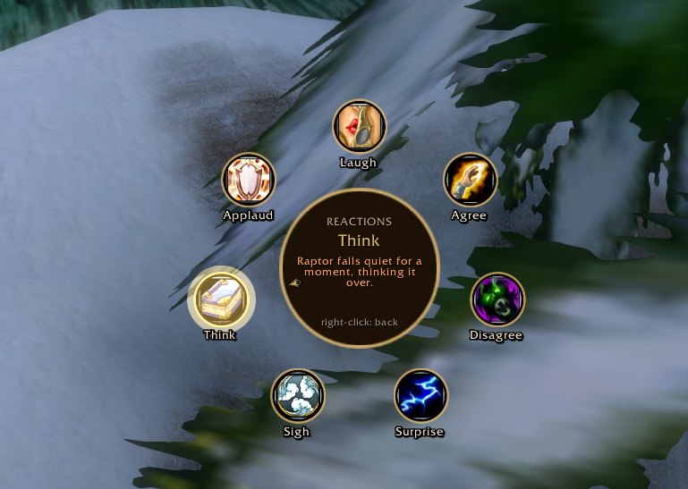
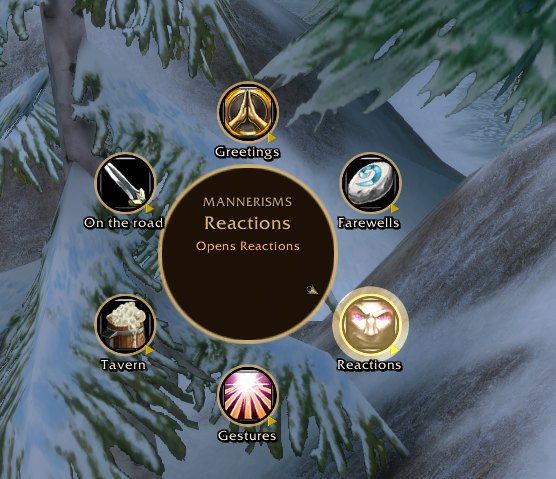

# Mannerisms

**Name:** Mannerisms
**Summary:** Ring menus of roleplay emotes, OPie style. Hold a key, flick toward a greeting, toast or gesture, let go.
**Game:** World of Warcraft: Forever · interface 16001
**Categories:** Roleplay, Chat & Communication, Action Bars
**Logo:** `.github/assets/logo-mm.png`
**Screenshots:** `mm-reactions.jpg` (main), `mm-main.jpg`, `mm-chat.jpg`
**Version:** 1.0.4 · `downloads/Mannerisms.zip`

## Description

```markdown


A ring menu for roleplay, inspired by OPie. **Hold a key** and a ring of emotes opens around your cursor. Rest on a category to open it, move toward an emote and **let go**: your character does it.

### Features
- Six rings to start with: **Greetings, Farewells, Reactions, Gestures, Tavern** and **On the road**, around 35 slices
- Each slice holds several lines and picks one at random, so you never repeat yourself
- Slices can be `/me` emotes, spoken `/say` lines, the game's own animated emotes, or open another ring
- The middle of the ring shows exactly what you're about to send
- Fill-ins: `{target}`, `{first}`, `{full}`, `{he}`/`{his}` and more, read from your **Total RP 3** profile
- `{target}` becomes *the dwarf man* if Well Met says you haven't met them yet
- A quick tap keeps the ring open for clicking; right-click goes back a ring
- Build and edit your own rings in-game with `/mm`, with up to six keys



### New to `/me`?
It describes what your character does, in third person: `/me leans on the bar.` shows *Raptor leans on the bar.* to everyone nearby.

Part of **Hearth & Hide**, a set of roleplay addons for WoW: Forever.
Source: https://github.com/actualraptor/hearth-hide
```

## Changelog (1.0.4)

```markdown
First release on Wago.
- Hold-and-release ring menus with nested rings
- Six starter rings with randomized lines
- In-game ring editor with keybinding capture
```
