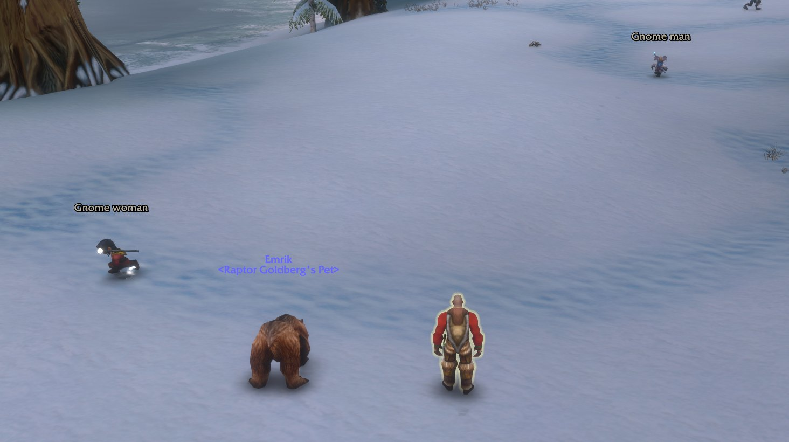
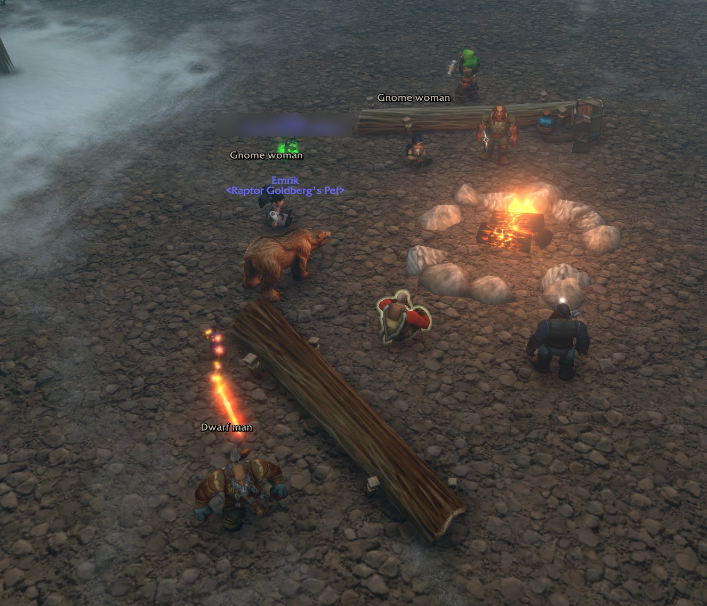

# Well Met

**Name:** Well Met
**Summary:** Strangers' names stay hidden until they tell you who they are. Built for RP servers, works with Total RP 3 and EllesmereUI.
**Game:** World of Warcraft: Forever · interface 16001
**Categories:** Roleplay, Unit Frames / Nameplates, Tooltip
**Logo:** `.github/assets/logo-wm.png`
**Screenshots:** `wm-snow.jpg` (main), `campfire.jpg`
**Version:** 1.6.0 · `downloads/WellMet.zip`

## Description

```markdown


On an RP server everyone's name hangs over their head, so you know the hooded stranger at the bar before they've said a word. **Well Met** covers players' names until you'd actually know them. Until then they're *Gnome woman*, *Dwarf man*, or just *Stranger*.

### Learning names
- Someone says their name in `/say`, `/yell`, `/emote` or a whisper, and you know them from then on. Their **Total RP 3** name counts too.
- Guildmates, your group, your friends list and anyone you've set a **Total RP 3 relationship** with count as known (each can be turned off).
- Mark anyone known or a stranger again with `/wmet know` or a right-click on the introduce button.
- Each of your characters keeps its own list of who it has met.

### Where names are hidden
- Nameplates (Blizzard and **EllesmereUI**), including the RP names Total RP 3 writes onto them
- Your target frame, keeping the level: `13 | Gnome woman`
- Total RP 3's target bar (the name above its buttons)
- Tooltips, including Total RP 3's, with its in-character / OOC marker kept
- The game's floating names, so players too far for a nameplate show no name at all
- Pet and totem labels, and a stranger's pet shows as *A stranger's Pet*
- The game's emote lines: *You thank the Human woman.* / *A Human woman waves at you.*
- Local chat: *[Human woman] says:* in `/say`, `/yell` and `/emote` (standard chat only; Trade, General, party and guild are left alone)
- Optional: only hide players who use Total RP 3

### Introducing yourself
An **introduce button** sits beside your target frame when you target a player, and glows while they're a stranger. It posts a random emote built from your Total RP 3 profile: name, title, profession, motto and pronouns. Write your own lines in `/wellmet`.

### Also
Tooltips say whether someone uses **Total RP 3** and whether they're **in character**.



### Commands
- `/wellmet` or `/wmet`: settings and your introductions (the game keeps `/wm` for itself)
- `/wmet intro`, `/wmet know`, `/wmet list`, `/wmet debug`

Part of **Hearth & Hide**, a set of roleplay addons for WoW: Forever.
Source: https://github.com/actualraptor/hearth-hide
```

## Changelog (1.6.0)

```markdown
First release on Wago.
- Hides strangers' names on nameplates, target frame, tooltips, floating names and pet labels
- Learns names from chat, guild, group and friends
- Introduce button built from your Total RP 3 profile
- Total RP 3 status line in tooltips; works with TRP3 nameplates and companion tooltips
- EllesmereUI support
```
